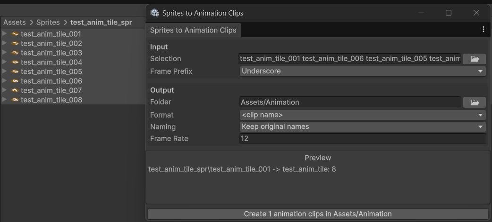

# Sprites to animation clips

This is a Unity editor tool that helps with batch creation of animation clips from sprite sequences.

Select a folder containing your sprites,

 or manually select the sprites,

 

when set the output folder and click 'Create'. The rest of the fields are self-expanatory.

## Installation

Unity -> Window -> Package management -> Package Manager -> '+' -> Install package from git URL -> "https://github.com/zurfer/sprites-to-clips.git"

## License

MIT
